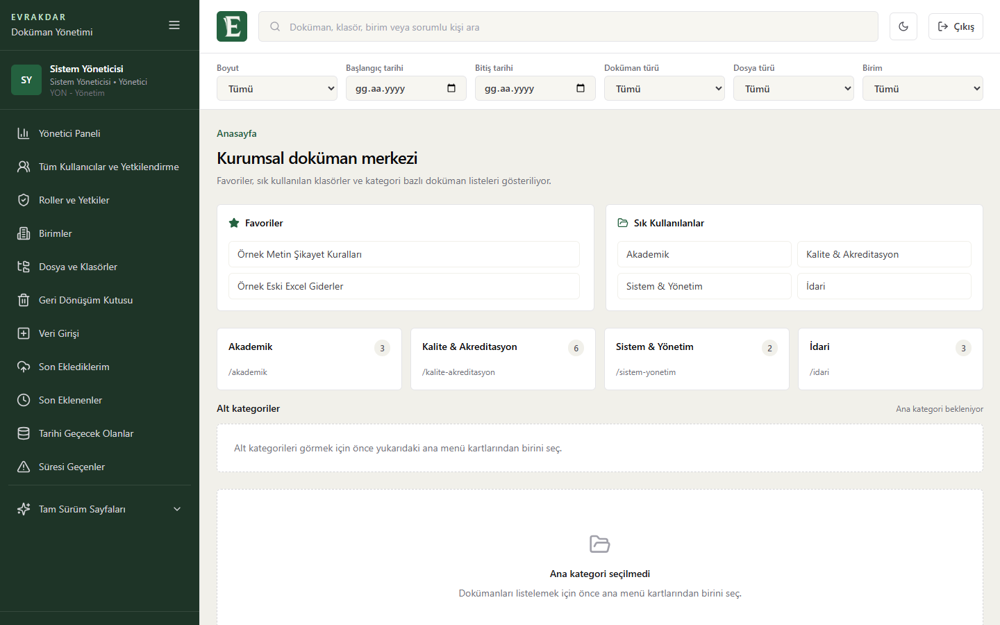
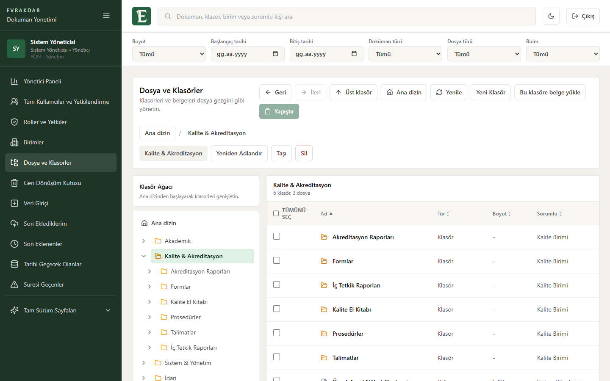
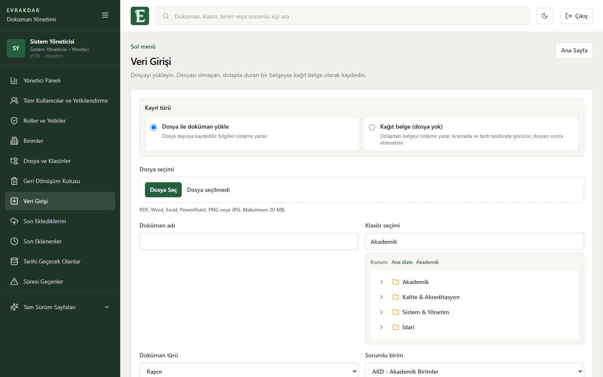
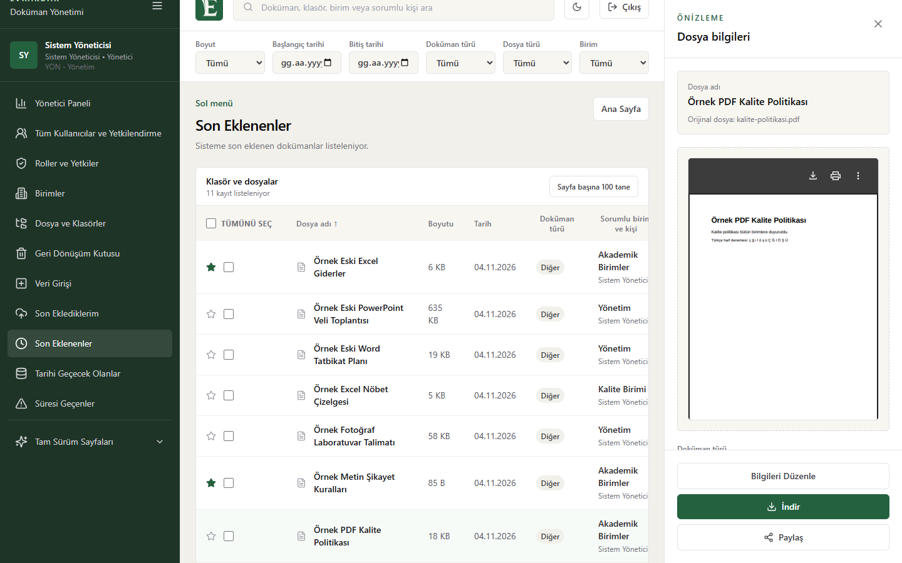
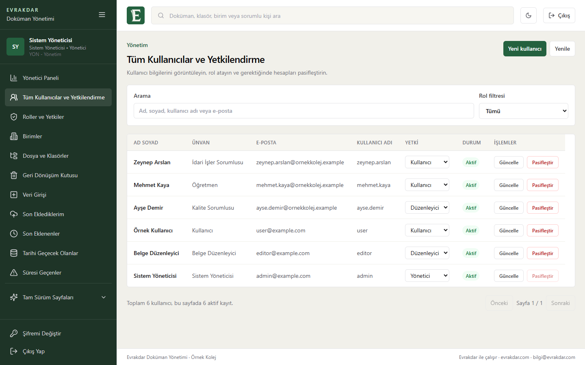
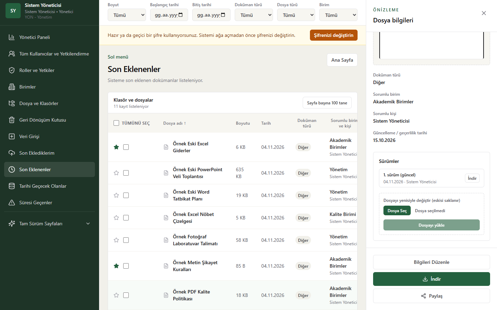
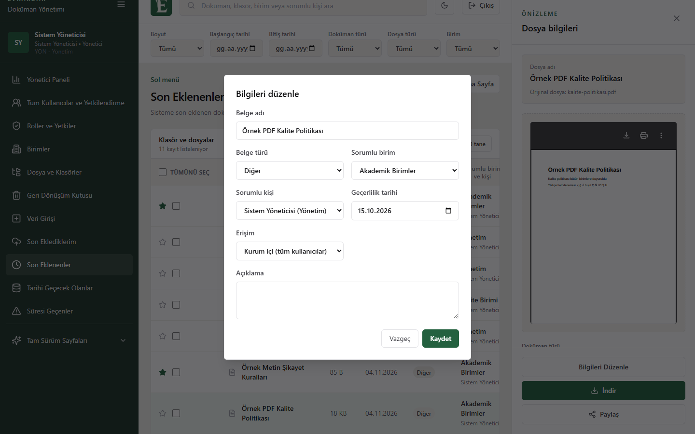
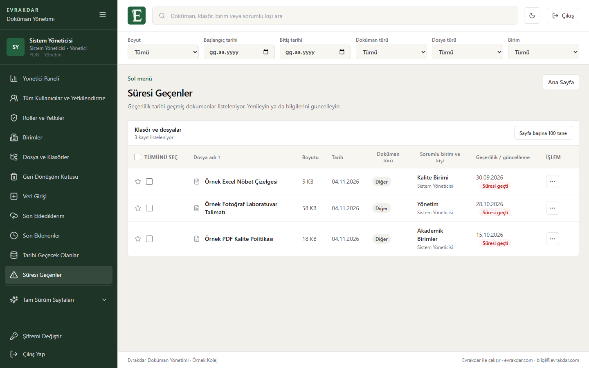
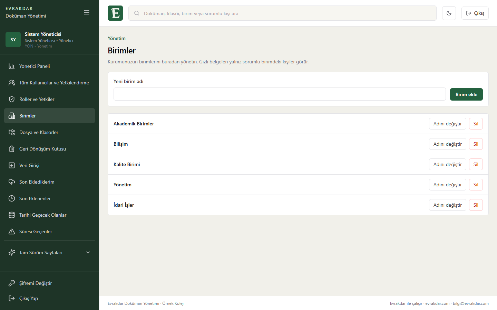
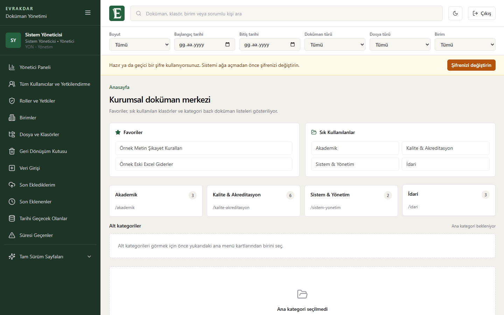

# Evrakdar

**Okullar ve küçük kurumlar için açık kaynak belge yönetim sistemi.**

Belgelerinizi klasör ağacında tek yerde toplayın, kimin neyi görebileceğini belirleyin, süresi yaklaşan belgeleri kaçırmayın. Kendi bilgisayarınıza ya da sunucunuza kurulur, belgeleriniz sizde kalır.

*Open-source document management for schools and small institutions. Self-hosted, Turkish interface.*



## İçindekiler

- [Bu depoda ne var](#bu-depoda-ne-var)
- [Kurulum](#kurulum)
- [Kullanım](#kullanım)
- [Paketler](#paketler)
- [Bakım](#bakım)
- [Geliştiriciler için](#geliştiriciler-için)
- [İletişim](#iletişim)
- [Lisans](#lisans)

## Bu depoda ne var

Bu depo Evrakdar'ın bedava **Evrakdar Filiz** paketidir:

- Kullanıcı girişi ve üç rol: yönetici, düzenleyici, kullanıcı
- Yönetici ekranından kullanıcı ekleme, rol verme, şifre sıfırlama
- Herkesin kendi şifresini değiştirebilmesi
- Klasör ağacı, taşıma, kopyalama, yeniden adlandırma
- Dosya yükleme (PDF, Word, Excel, PowerPoint, metin, görsel), önizleme ve indirme
- Belge bilgilerini sonradan düzeltme: ad, tür, sorumlu birim, geçerlilik tarihi, gizlilik, açıklama
- Dosyayı yenisiyle değiştirme ve eski sürümleri saklama
- Kurumun kendi birimlerini ekleme ve düzenleme
- Tarihi geçecek belgeler ve süresi geçmiş belgeler listeleri, son eklenenler, favoriler, çöp kutusu
- Gizli belge: yalnız yöneticiler, oluşturan kişi, sorumlu kişi ve sorumlu birim görür, değiştirebilir
- Belge adında, bilgilerinde ve dijital PDF, Word (.docx), metin dosyalarının içinde arama
- Açık ve koyu tema

Rollerin neler yapabildiği yönetici menüsündeki **Roller ve Yetkiler** sayfasında görünür. Yönetici menüsünün altındaki **Tam Sürüm Sayfaları** bölümü, tam sürümdeki ekranları örnek bilgilerle gösterir; bu sayfalar çalışmaz, sunucuya bir şey sormaz. Onay akışı, işlem kayıtları, taranmış belgeden yazı okuma ve gelişmiş arama **Fidan** ve **Çınar** paketlerindedir. Karşılaştırma için [Paketler](#paketler) bölümüne bakın.

## Kurulum

Gereken tek program [Docker Desktop](https://www.docker.com/products/docker-desktop/). Linux sunucuda Docker Engine yeterli. En az 4 GB bellek ve 20 GB boş disk önerilir.

1. Docker Desktop'ı kurup açın.
2. Bu depoyu indirin: `git clone https://github.com/evrakdar/evrakdar-filiz.git` ya da **Code > Download ZIP**.
3. Klasörün içinde kurulum dosyasını çalıştırın:

   ```powershell
   # Windows (PowerShell)
   powershell -ExecutionPolicy Bypass -File kur.ps1
   ```

   ```bash
   # Linux ve macOS
   sh kur.sh
   ```

4. Kurumunuzun adını yazın. İlk kurulum 5-15 dakika sürebilir.
5. Tarayıcıdan **http://localhost:3000** adresini açın ve aşağıdaki hesaplardan biriyle girin.

| Kullanıcı adı | Şifre | Rol |
| --- | --- | --- |
| `admin` | `1234` | Yönetici |
| `editor` | `1234` | Düzenleyici |
| `user` | `1234` | Kullanıcı |

Bu şifreler yalnız başlangıç içindir. Sistem kurulduğu bilgisayardan dışarı açık değildir, o yüzden denerken rahatça kullanabilirsiniz. Ekrandaki uyarıdan ya da **Şifremi Değiştir** düğmesinden kendi şifrenizi belirleyin.

> **Sistemi okul ağına ya da internete açarsanız** `1234` ile giriş kendiliğinden kapanır. Şifresini değiştirmemiş hesaplara kurulum sırasında yeni şifre verilir ve ilk girişte değiştirmeleri istenir.

Okul ağından erişim, internete açma (HTTPS), başka port kullanma ve sorun giderme için [Kurulum ve Bakım rehberi](docs/kurulum.md).

## Kullanım

Ayrıntılı anlatım: [Kullanım rehberi](docs/kullanim.md).

### Nerede ne yapılır

| Yapmak istediğiniz | Gideceğiniz yer | Kim yapabilir |
| --- | --- | --- |
| Kendi şifresini değiştirmek | Sol alttaki Şifremi Değiştir | Herkes |
| Kullanıcı eklemek, rol vermek, şifre sıfırlamak | Tüm Kullanıcılar ve Yetkilendirme | Yönetici |
| Birim eklemek, adını değiştirmek | Birimler | Yönetici |
| Genel sayıları görmek | Yönetici Paneli | Yönetici |
| Dosya yüklemek ya da dolaptaki kağıt belgeyi kaydetmek | Veri Girişi | Yönetici, Düzenleyici |
| Belgeyi gizli yapmak | Veri Girişi > Erişim > Gizli | Yönetici, Düzenleyici |
| Klasör açmak, taşımak, kopyalamak, silmek | Dosya ve Klasörler | Yönetici, Düzenleyici |
| Silineni geri almak ya da kalıcı silmek | Geri Dönüşüm Kutusu | Yönetici, Düzenleyici |
| Belge bilgilerini düzeltmek | Belgeye tıklayın, sağdaki panelde Bilgileri Düzenle | Yönetici, Düzenleyici |
| Dosyayı yenisiyle değiştirmek, eski sürümü indirmek | Belgeye tıklayın, sağdaki panelde Sürümler | Değiştirmek: Yönetici, Düzenleyici. İndirmek: Herkes |
| Kendi eklediklerini görmek | Son Eklediklerim | Yönetici, Düzenleyici |
| Süresi yaklaşan belgeleri görmek | Tarihi Geçecek Olanlar | Herkes |
| Süresi geçmiş belgeleri görmek | Süresi Geçenler | Herkes |
| Yeni eklenenleri görmek | Son Eklenenler | Herkes |
| Belge aramak | Üstteki arama kutusu | Herkes |
| Belgeye bakmak, indirmek | Satıra tıklayın, sağda panel açılır | Herkes |
| Favorilere eklemek | Satırdaki yıldız | Herkes |

### Ekranlar

| Dosya ve Klasörler | Veri Girişi |
| --- | --- |
|  |  |

| Belge önizleme | Kullanıcılar |
| --- | --- |
|  |  |

| Sürümler | Bilgileri düzenleme |
| --- | --- |
|  |  |

| Süresi geçenler | Birimler |
| --- | --- |
|  |  |

| İlk giriş uyarısı |
| --- |
|  |

Ekranlardaki kurum, kişi ve belge adları örnektir.

### Bilmeniz gerekenler

- Belge içinde arama dijital PDF, Word (.docx) ve metin dosyalarında çalışır. Taranmış belgeler, eski .doc dosyaları ve Excel içinde arama yapılmaz.
- Bir dosya en fazla 20 MB olabilir.
- "Tarihi Geçecek Olanlar" önümüzdeki 30 günü, "Süresi Geçenler" tarihi dolanları gösterir. Belge son gününe kadar geçerli sayılır. E-posta hatırlatma Fidan paketindedir.
- Bu sürüm kim ne yaptı kaydı tutmaz.
- Sistem hiçbir yere bilgi göndermez. Belgeleriniz yalnız kurduğunuz yerde durur. İnternet yalnız ilk kurulum ve güncelleme için gerekir.

## Paketler

İşaretler: ✅ var, 🔜 pakete girecek ama henüz hazır değil, ➖ bu pakette yok.

| Özellik | Filiz (bedava, bu depo) | Fidan (okullar için) | Çınar (kurumlar için) |
| --- | :---: | :---: | :---: |
| Giriş, üç rol, kullanıcı ve birim yönetimi | ✅ | ✅ | ✅ |
| Klasörler, yükleme, önizleme, indirme, çöp kutusu | ✅ | ✅ | ✅ |
| Belge bilgisi düzenleme, sürüm geçmişi | ✅ | ✅ | ✅ |
| Tarihi geçecek ve süresi geçen belgeler, gizli belge, favoriler | ✅ | ✅ | ✅ |
| Belge adında, bilgilerinde ve dijital belge içinde arama | ✅ | ✅ | ✅ |
| Onay akışı ve onay geçmişi | ➖ | ✅ | ✅ |
| Kim ne zaman ne yaptı kaydı | ➖ | ✅ | ✅ |
| Taranmış belgeden yazı okuma, gelişmiş arama | ➖ | ✅ | ✅ |
| Tarihi gelen belge için e-posta hatırlatma | ➖ | ✅ | ✅ |
| Hazır klasör şablonları, denetim raporu | ➖ | 🔜 | 🔜 |
| Kendi rollerini tanımlama, yetkileri tek tek açıp kapatma | ➖ | ✅ | ✅ |
| Kendi logosu ve renkleri, kurum bilgileri, e-posta önerisi | ➖ | ✅ | ✅ |
| Word, Excel, PowerPoint dosyalarını sayfa düzeniyle önizleme | ➖ | ✅ | ✅ |
| Kurum hesabıyla giriş, birime özel erişim, çok kampüs | ➖ | ➖ | 🔜 |
| Kurulum | Kendiniz | Biz | Biz |
| Güncelleme | Kendiniz | Biz | Biz |
| Destek | GitHub | E-posta | Öncelikli |
| Fiyat | Bedava | Kurulum + yıllık bakım | Teklifle |

Satır satır tam liste: [Paket karşılaştırması](docs/paketler.md).

Fidan ya da Çınar paketi, kurulum desteği ve teklif için [İletişim](#iletişim) bölümündeki adresten yazabilirsiniz.

## Bakım

| İş | Nasıl |
| --- | --- |
| Durdurmak, başlatmak | [Günlük işlemler](docs/kurulum.md#günlük-işlemler) |
| Yedek almak, geri yüklemek | [Yedekleme](docs/kurulum.md#yedekleme) |
| Yeni sürüme geçmek | [Güncelleme](docs/kurulum.md#güncelleme) |
| Yönetici şifresini kurtarmak | [Şifremi unuttum](docs/kurulum.md#yönetici-şifresini-unuttum) |
| Bir şey çalışmıyor | [Sorun giderme](docs/kurulum.md#sorun-giderme) |

Güvenlik notları ve açık bildirme yolu: [SECURITY.md](SECURITY.md).

## Geliştiriciler için

Gerekenler: Node.js 22, npm, Docker.

```bash
npm install
cp .env.example .env            # Windows: Copy-Item .env.example .env
npm run docker:up               # veritabanı
npm --workspace @evrakdar/api run prisma:migrate
npm --workspace @evrakdar/api run prisma:seed
npm run dev:api                 # http://localhost:3001
npm run dev:web                 # http://localhost:3000
```

`.env.example` geliştirme ve testler için ayrı hesaplar açar: `admin/admin123`, `editor/editor123`, `viewer/viewer123`. Gerçek kurulumda bu hesaplar oluşturulamaz.

Kontroller:

```bash
npm run typecheck
npm run lint
npm run build
npm run test:e2e:web     # servisler açık ve deneme hesapları yüklü olmalı
```

| Klasör | İçerik |
| --- | --- |
| `apps/api` | NestJS API, Prisma şeması ve veritabanı değişiklikleri |
| `apps/web` | Next.js arayüzü ve Playwright testleri |
| `packages/shared` | Ortak tipler |
| `docker` | Docker dosyaları |
| `docs` | Kurulum, kullanım ve paket belgeleri |

Teknolojiler: Next.js 16, React 19, NestJS 11, TypeScript, PostgreSQL 16, Prisma 7, Tailwind CSS, Playwright, pdf-parse, mammoth. Dosyalar sunucu diskinde ya da isteğe bağlı olarak S3 uyumlu bir depoda durur.

## İletişim

E-posta: [bilgi@evrakdar.com](mailto:bilgi@evrakdar.com)

Hata bildirimi ve öneriler için GitHub **Issues** bölümünü de kullanabilirsiniz.

## Lisans

Copyright (C) 2026 Evrakdar

[GNU AGPL v3.0](LICENSE). Kullanabilir, değiştirebilir, dağıtabilirsiniz. Değiştirip ağ üzerinden hizmet olarak sunarsanız kaynak kodunu da paylaşmanız gerekir. Kapalı kaynak kullanım için ticari lisans gerekir, [iletişime geçin](#iletişim).
